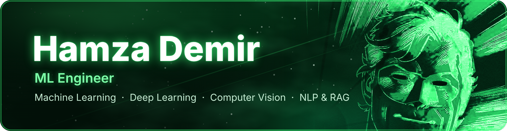

  

  
  
  
  
  
  

  I turn machine learning experiments into focused, measured work: neural video compression, anomaly detection, retrieval and computer vision. 
  Open to internships, junior ML roles and collaborations.

## Selected work

<table>
  <tr>
    <td colspan="2" valign="top">
      <h3><a href="https://github.com/wHamza/commaOwnTry">comma Video Compression Challenge</a> &nbsp;</h3>
      My own HNeRV-style implicit decoder (~243K params) trained with 7-bit quantization-aware training, an entropy penalty and task losses through frozen SegNet/PoseNet evaluators. Score 0.33 &rarr; 0.240. Reproduced the public #128 submission exactly and showed why cheap post-hoc fixes cannot pay for their bytes. Full research log, negative results included.  
         
    </td>
  </tr>
  <tr>
    <td colspan="2" valign="top">
      <h3><a href="https://github.com/wHamza/cattle-anomaly-mmcows">Cattle Behaviour Anomaly Detection</a> &nbsp;</h3>
      Label-free detection of lethargy-like behaviour in dairy cows from hourly wearable-sensor data (MMCOWS). Herd-relative robust z-scores, an alarm budget instead of an arbitrary threshold, and evaluation through a physiological proxy plus synthetic drills.  
        
    </td>
  </tr>
  <tr>
    <td colspan="2" valign="top">
      <h3>ING Hubs Türkiye Datathon &nbsp;</h3>
      Customer churn prediction on a heavily imbalanced dataset (about 95% / 5%). Individual entry, ensemble model, October 2025.  
        
    </td>
  </tr>
  <tr>
    <td width="50%" valign="top">
      <h3><a href="https://github.com/wHamza/readbuddy-rag">ReadBuddy RAG</a></h3>
      Spoiler-safe reading companion: hybrid retrieval over a book that only uses what you have already read.  
        
    </td>
    <td width="50%" valign="top">
      <h3><a href="https://github.com/wHamza/routeOptimGNN">Route Optim GNN</a></h3>
      Vehicle routing with graph attention and reinforcement learning, with benchmark scripts and route plots.  
        
    </td>
  </tr>
  <tr>
    <td width="50%" valign="top">
      <h3><a href="https://github.com/wHamza/gnn-steam-2021-turkish">Steam Game Recommender</a></h3>
      Heterogeneous GNN on Turkish Steam reviews; users and games are nodes, recommendation is link prediction.  
       
    </td>
    <td width="50%" valign="top">
      <h3><a href="https://github.com/wHamza/line-recog">Underwater Route Recognition</a></h3>
      YOLO-based line detection with vehicle-control experiments over PyMAVLink.  
       
    </td>
  </tr>
  <tr>
    <td width="50%" valign="top">
      <h3><a href="https://github.com/wHamza/Voice-control-with-hand">Hand-Controlled Volume</a></h3>
      Touch-free Windows volume control with MediaPipe hand landmarks.  
       
    </td>
    <td width="50%" valign="top">
      <h3><a href="https://github.com/wHamza/TensorTonic-Solutions">TensorTonic Solutions</a></h3>
      ML fundamentals implemented from scratch with NumPy: losses, activations, closed-form regression.  
       
    </td>
  </tr>
</table>

## Currently exploring

- Neural video compression: implicit decoders, quantization-aware training, distillation
- Post-training of open language models (Gemma 4)
- Edge ML for livestock monitoring with low-power sensors

  

